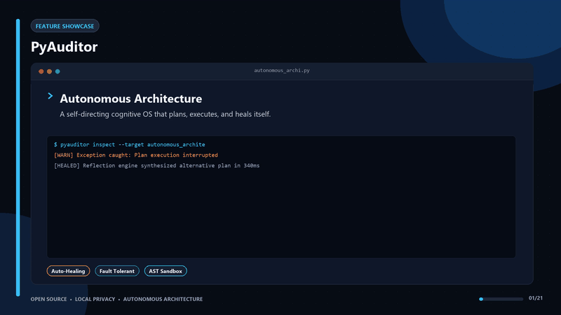

<div align="center">

[](https://github.com/oguzemirtopuz/PyAuditor/releases/latest)
[](https://www.python.org)
[-brightgreen?style=for-the-badge)](#)
[](#)
[](#)
[](LICENSE)

<h1>🔬 PyAuditor</h1>
<h3>No pip install. No API keys. Paste it in and see every bug you're about to ship.</h3>

<p><em>25-rule AST static analysis · BYOAI prompt generator · Sub-2-second scans · Zero configuration</em></p>

</div>

<div align="center">
  
</div>

---

## 🎯 What Problem Does This Solve?

Python has a dark side: it runs broken code silently.

A coroutine called without `await` does absolutely nothing — no error, no warning. An `except: pass` block swallows every exception, including `KeyboardInterrupt`. A `mutable_default_arg` like `def f(x=[])` shares state across every call. Your code ships, runs in production, and quietly fails.

Standard linters catch style issues. Type checkers catch type mismatches. **But no standard tool catches the category of bugs that are syntactically valid, pass all tests, and still produce wrong behavior at runtime.**

**PyAuditor** runs two analysis passes to surface these:

1. **Layer 1 — Static Scan (Instant, Offline):** 25 specialized AST rules scan every `.py` file with no code executed. Results in under 2 seconds for thousands of lines.
2. **Layer 2 — BYOAI Prompt Generator:** Generates an optimized, context-rich prompt wrapping your code. Paste it into ChatGPT, Claude, or Gemini to detect logical errors that no static rule can find — without API limits or privacy concerns.

---

## 👥 Who This Is For

- **Python developers** who want a fast, honest pre-commit code review
- **Teams** who need a portable, zero-setup audit tool that works on any machine
- **Students and learners** who want to understand exactly what their code does wrong and why
- **CI pipeline builders** who want a foundation for automated code quality gates
- **Anyone** who has shipped a bug that no linter caught

---

## 🔥 Problems It Solves

| The Bug Category | What PyAuditor Detects |
|---|---|
| Silent async failures | Coroutine called without `await` — does nothing, no error |
| Deadlock setup | `asyncio.Lock` lazy-init race condition |
| Blocking async | `time.sleep()` or `requests.get()` inside `async def` |
| Swallowed errors | `except: pass` — the error disappears silently |
| Shared mutable state | `def f(x=[])` — all calls share the same list |
| Shadowed builtins | Variable named `list`, `dict`, `str` — you've overwritten Python |
| Dead parameters | Declared but never used in the function body |
| Unused class state | `self.x` set in `__init__` but never read anywhere |
| Logic errors | Off-by-one, wrong algorithm, wrong variable — caught by the AI layer |

---

## ⚡ Key Benefits

- **Zero friction:** No `pip install`, no virtual environment, no config files. Just run `python auditor_app.py`.
- **Complete findings:** Every detected issue includes Detail (what's wrong), Risk (what breaks at runtime), and Fix (exact instruction to resolve it).
- **Private by design:** The BYOAI model means you control what code goes to the AI — no silent API calls.
- **Model agnostic:** The generated prompt is engineered to produce structured JSON output from any modern LLM (ChatGPT, Claude, Gemini, Llama).
- **Cross-platform:** Pure `tkinter` — runs on Windows, macOS, and Linux with no platform lock-in.
- **Self-updating:** `python update.py` downloads the latest release, backs up your files, and applies the update automatically.

---

## 🎯 Severity Levels

| Level | Color | Meaning |
|---|---|---|
| 🔴 **CRITICAL** | Red | Will crash or produce fatal failure at runtime |
| 🟡 **WARNING** | Yellow | Runs but does the *wrong thing* silently |
| 🟠 **POTENTIAL** | Orange | Works today — time-bomb for the future |
| 🔵 **INFO** | Blue | Code quality and maintainability suggestions |
| 🟣 **LOGIC** | Purple | AI-detected logical errors (wrong behavior, no crash) |

---

## 🛠️ Technical Architecture

```
PyAuditor/
├── auditor_app.py          # Main application — tkinter dark-mode GUI
│
├── engine/
│   ├── scanner.py          # File discovery + AST parsing + rule runner
│   ├── finding.py          # Finding dataclass: level, detail, risk, fix
│   ├── ai_prompt.py        # BYOAI Prompt Generator
│   └── rules/
│       ├── base.py         # Abstract Rule base class
│       ├── async_rules.py  # asyncio / concurrency rules (4 rules)
│       ├── safety_rules.py # Exception handling, mutable defaults (9 rules)
│       ├── dead_code.py    # Unused params, attrs, imports, widgets (6 rules)
│       ├── design.py       # Long functions, nesting, type hints (4 rules)
│       └── potential.py    # Magic numbers, paths, TODOs (7 rules + custom)
│
└── history/                # Auto-saved scan history (JSON, for trend tracking)
```

**How the AST Engine Works:**

PyAuditor parses every `.py` file into Python's built-in Abstract Syntax Tree. Each of the 25 rules is a visitor that traverses the tree looking for specific node patterns — no code is executed at any point. The `blocking_in_async` rule uses **Smart AST Scoping** to ignore synchronous calls safely wrapped inside `run_in_executor` patterns, eliminating false positives for heavy async workloads.

---

## 📋 Rule Catalogue (25 Static Rules)

### 🔴 Critical — Async & Concurrency
| Rule ID | What It Detects |
|---|---|
| `asyncio_lock_race` | `asyncio.Lock` lazy-init race condition |
| `blocking_in_async` | `time.sleep` / `requests.get` inside `async def` *(Smart AST: ignores `run_in_executor` scopes)* |
| `missing_await` | Coroutine called without `await` — silently does nothing |
| `syntax_error` | File cannot be parsed by Python |

### 🟡 Warning — Safety
| Rule ID | What It Detects |
|---|---|
| `bare_except` | `except:` catches `SystemExit` and `KeyboardInterrupt` |
| `except_pass` | `except: pass` — error silently swallowed |
| `mutable_default_arg` | `def f(x=[])` — shared mutable default |
| `shadow_builtin` | Variable named `list`, `dict`, `str`, etc. |
| `os_exit_bypass` | `os._exit()` skips all Python cleanup |
| `dead_parameter` | Parameter declared but never used in body |
| `unused_self_attr` | `self.x` assigned in `__init__` but never read |
| `widget_not_packed` | Tkinter widget created but never laid out |
| `duplicate_list_items` | Duplicate constants in a list literal |

### 🟠 Potential — Future Risks
| Rule ID | What It Detects |
|---|---|
| `magic_number` | Unexplained numeric literal in comparisons/assignments |
| `todo_fixme` | `TODO` / `FIXME` / `HACK` / `BUG` comments |
| `hardcoded_path` | Absolute filesystem path (`C:\...`, `/home/...`) |
| `print_statement` | `print()` call bypassing the logging framework |
| `broad_exception_catch` | `except Exception` without re-raise |
| `multiword_stopword` | Space-separated stop word that can never match a tokenizer |
| `stale_log_value` | Log message references a threshold not present in code |

### 🔵 Info — Design & Quality
| Rule ID | What It Detects |
|---|---|
| `long_function` | Function longer than 80 lines |
| `deep_nesting` | 4+ levels of `if`/`for`/`while` nesting |
| `missing_type_hint` | Public function missing parameter or return type |
| `missing_docstring` | Public class or function missing docstring |
| `long_line` | Line longer than 120 characters |
| `unused_import` | Import never referenced in the file |

---

## 🔑 Why BYOAI Instead of Direct API Integration

| Traditional Approach | PyAuditor BYOAI |
|---|---|
| API rate limits hit during large projects | No limits — use your existing session |
| API costs accumulate | Your existing subscription, no extra cost |
| Code silently sent to a third party | You manually control what goes to the AI |
| Locked to one AI model | Use Claude, ChatGPT, Gemini, Llama — your choice |

The generated system prompt is structured to coerce any modern LLM to respond in PyAuditor's exact JSON schema — consistent, parseable output regardless of which model you use.

---

## 🚀 Installation & Usage

### 1. Clone the Repository

```bash
git clone https://github.com/oguzemirtopuz/PyAuditor.git
cd PyAuditor
```

### 2. Run the Application

```bash
python auditor_app.py
```

No `pip install`. No virtual environment. No setup.py. That's it.

### 3. Run an AI Audit (Optional)

1. Select the files you want to analyze in the UI
2. Click **📋 COPY AI PROMPT**
3. Paste into **ChatGPT**, **Claude**, or **Gemini**
4. Receive a structured report of logical errors

### 4. Auto-Update

```bash
python update.py
```

Downloads the latest version, backs up your current files, and applies the update — preserving your local settings and scan history.

---

## ⚙️ GUI Features

- **Dark-mode interface** — color-coded severity rows with professional dark theme
- **Interactive detail panel** — click any finding to see full Detail / Risk / Fix
- **Filter by severity** — show only CRITICAL, or only LOGIC, etc.
- **Copy for AI** — one click copies any finding in AI-ready format
- **Open in Editor** — double-click any finding to jump to that exact line in VS Code
- **Save TXT Report** — export the full audit as a portable text file
- **Scan history** — trend indicator shows improvement vs. last run
- **Rule toggles** — enable/disable individual rules or whole categories
- **Zero-config** — works on any Python project structure

---

## 🗺️ Roadmap

- [ ] JavaScript / TypeScript support (Tree-Sitter based)
- [ ] Severity threshold configuration (fail CI if CRITICAL > 0)
- [ ] GitHub Actions integration
- [ ] Diff mode — show only *new* findings vs. previous scan
- [ ] Export to JSON / HTML report

---

## 🤝 Contributing

Contributions welcome. Priority areas:

- New AST rule implementations (especially for common Django/Flask patterns)
- JavaScript/TypeScript scanner backend
- GitHub Actions YAML template
- Additional BYOAI prompt strategies for specific domains

---

## 📄 License

MIT License — see [LICENSE](LICENSE) for details.

---

<div align="center">
  <sub>Built by <a href="https://github.com/oguzemirtopuz">Oğuz Emir Topuz</a></sub>
  <br/>
  <sub>⭐ If PyAuditor caught a bug before it shipped, give it a star.</sub>
</div>
